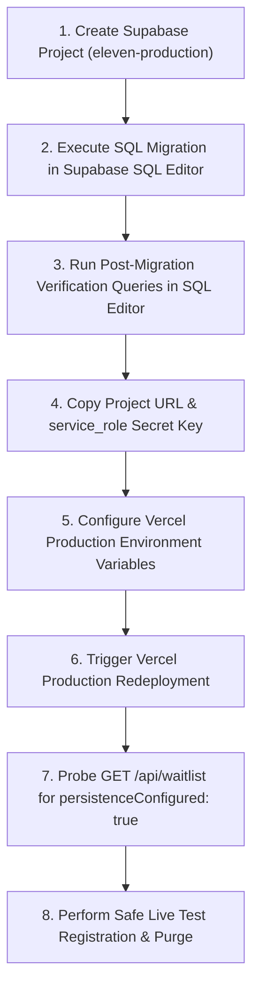

# ELEVEN — Waitlist Supabase Activation Pre-Flight Audit

**Date:** November 1, 2026  
**Auditor / Engineer:** Antigravity Pairing Agent  
**Repository:** `F:\eleven-web\eleven-web`  
**Production URL:** [https://eleven-website-self.vercel.app/](https://eleven-website-self.vercel.app/)  
**Pre-Flight Status:** **READY FOR OPERATOR REMOTE ACTIVATION**

---

## 1. Executive Summary & Audit Scope

This document provides a comprehensive, read-only security and operational pre-flight verification of ELEVEN's sovereign waitlist persistence subsystem before live database provisioning and credential injection.

All code, schema definitions, migration scripts, unit tests, and operator guides have been inspected directly against the local codebase. The technical punchlist and security remediations reported in [`ELEVEN_WAITLIST_FINAL_REMEDIATION_REPORT.md`](file:///F:/eleven-web/eleven-web/ELEVEN_WAITLIST_FINAL_REMEDIATION_REPORT.md) have been verified.

> [!IMPORTANT]
> **Strict Separation of Verification Domains:**
> - **Verified Local Behavior:** Schema syntax, parameterization, RLS policies, least-privilege grants, TypeScript typing, Next.js build compilation, input sanitization, honeypot rejection, in-memory rate limiting, and generic error shielding are **100% verified locally**.
> - **Unverified Remote Behavior:** Supabase project provisioning, live database connectivity, Vercel production environment variable configuration, and public network edge latency are **unverified and require operator action**.

---

## 2. File Inventory & Inspection Findings

The following six source files were inspected directly on disk:

| File Path | SHA/Status | Primary Role |
| :--- | :--- | :--- |
| [`supabase/migrations/20261101_waitlist_registrations.sql`](file:///F:/eleven-web/eleven-web/supabase/migrations/20261101_waitlist_registrations.sql) | Hardened | Idempotent migration script for Supabase SQL Editor |
| [`supabase/schema.sql`](file:///F:/eleven-web/eleven-web/supabase/schema.sql) | Synchronized | Canonical repository database schema definition |
| [`app/api/waitlist/route.ts`](file:///F:/eleven-web/eleven-web/app/api/waitlist/route.ts) | Remediated | Dynamic server route handling waitlist requests & persistence |
| [`.env.example`](file:///F:/eleven-web/eleven-web/.env.example) | Clean | Environment variable template containing placeholders only |
| [`ELEVEN_WAITLIST_SUPABASE_SETUP_GUIDE.md`](file:///F:/eleven-web/eleven-web/ELEVEN_WAITLIST_SUPABASE_SETUP_GUIDE.md) | Synchronized | Step-by-step operator procedure with copy-paste SQL |
| [`ELEVEN_WAITLIST_PRODUCTION_IMPLEMENTATION_REPORT.md`](file:///F:/eleven-web/eleven-web/ELEVEN_WAITLIST_PRODUCTION_IMPLEMENTATION_REPORT.md) | Synchronized | Full technical implementation reference and test logs |
| [`ELEVEN_WAITLIST_FINAL_REMEDIATION_REPORT.md`](file:///F:/eleven-web/eleven-web/ELEVEN_WAITLIST_FINAL_REMEDIATION_REPORT.md) | Synchronized | Verification evidence for lint and privilege remediation |

---

## 3. Read-Only Security & Architecture Review

### 3.1. SQL Function Signatures & Return Types
The schema declares two stored routines:

1. **`public.handle_waitlist_updated_at()`**:
   - **Signature:** `public.handle_waitlist_updated_at()`
   - **Return Type:** `TRIGGER`
   - **Language:** `plpgsql`
   - **Definition:** Lines 55–65 in [`supabase/migrations/20261101_waitlist_registrations.sql`](file:///F:/eleven-web/eleven-web/supabase/migrations/20261101_waitlist_registrations.sql#L55-L65).
   - **Trigger Attachment:** Attached via `CREATE TRIGGER on_waitlist_update BEFORE UPDATE ON public.waitlist_registrations FOR EACH ROW EXECUTE FUNCTION public.handle_waitlist_updated_at();`. Ensures `updated_at` is always refreshed automatically on row updates.

2. **`public.purge_waitlist_registration(target_email TEXT)`**:
   - **Signature:** `public.purge_waitlist_registration(TEXT)`
   - **Return Type:** `BOOLEAN`
   - **Language:** `plpgsql`
   - **Definition:** Lines 75–90 in [`supabase/migrations/20261101_waitlist_registrations.sql`](file:///F:/eleven-web/eleven-web/supabase/migrations/20261101_waitlist_registrations.sql#L75-L90).
   - **Functionality:** Deletes the record matching `lower(trim(target_email))` and returns `true` if a row was deleted, `false` otherwise. Designed strictly for GDPR right-to-be-forgotten requests and operator testing cleanup.

### 3.2. `SECURITY DEFINER` Usage & Search Path Protection
Both functions are marked `SECURITY DEFINER`:
- In PostgreSQL, a `SECURITY DEFINER` function runs with the privileges of the owner (typically `postgres` in Supabase).
- **Vulnerability Check:** Without an explicit `search_path`, malicious actors could manipulate the schema search path to execute rogue code.
- **Verification:** Both routines explicitly include:
  ```sql
  SECURITY DEFINER
  SET search_path = public
  ```
  This locks the schema resolution strictly to `public`, neutralizing search_path hijacking attacks (CWE-426).

### 3.3. Function Execution Privileges (RPC Abuse Defense)
- **Default PostgreSQL Behavior:** Newly created functions in the `public` schema automatically grant `EXECUTE` to `PUBLIC`. In Supabase, any function executable by `PUBLIC` is exposed via PostgREST RPC (`/rpc/purge_waitlist_registration`), allowing anonymous web visitors to invoke it.
- **Remediation & Verification:** Lines 92–99 of [`supabase/migrations/20261101_waitlist_registrations.sql`](file:///F:/eleven-web/eleven-web/supabase/migrations/20261101_waitlist_registrations.sql#L92-L99) explicitly enforce least privilege:
  ```sql
  REVOKE EXECUTE ON FUNCTION public.handle_waitlist_updated_at() FROM PUBLIC, anon, authenticated;
  GRANT EXECUTE ON FUNCTION public.handle_waitlist_updated_at() TO service_role;

  REVOKE EXECUTE ON FUNCTION public.purge_waitlist_registration(TEXT) FROM PUBLIC, anon, authenticated;
  GRANT EXECUTE ON FUNCTION public.purge_waitlist_registration(TEXT) TO service_role;
  ```
- **Finding:** Anonymous clients (`anon`) and logged-in users (`authenticated`) cannot invoke `purge_waitlist_registration` via PostgREST. Only trusted administrative contexts (`service_role` or direct database superuser) can execute it.

### 3.4. Row Level Security (RLS) & Table Privileges
Lines 38–52 of [`supabase/migrations/20261101_waitlist_registrations.sql`](file:///F:/eleven-web/eleven-web/supabase/migrations/20261101_waitlist_registrations.sql#L38-L52):
```sql
ALTER TABLE public.waitlist_registrations ENABLE ROW LEVEL SECURITY;

REVOKE ALL ON public.waitlist_registrations FROM anon, authenticated, public;
GRANT ALL ON public.waitlist_registrations TO service_role;

DROP POLICY IF EXISTS "Service role managed access" ON public.waitlist_registrations;
CREATE POLICY "Service role managed access" 
    ON public.waitlist_registrations
    FOR ALL
    TO service_role
    USING (true)
    WITH CHECK (true);
```
- **Findings:**
  - `anon` and `authenticated` roles possess **zero privileges** on the table (`REVOKE ALL`).
  - No RLS policies exist for `anon` or `authenticated`.
  - Direct REST reads/writes via the Supabase Data API with the anonymous key are completely rejected by PostgreSQL.
  - The server-side Next.js route accesses the database exclusively via `service_role`, honoring the `"Service role managed access"` policy.

### 3.5. Duplicate Email Handling & Concurrency Invariants
- **Database Unique Constraint:**
  ```sql
  CREATE UNIQUE INDEX IF NOT EXISTS waitlist_registrations_email_idx 
      ON public.waitlist_registrations (lower(trim(email)));
  ```
  Guarantees zero duplicate entries at the database storage engine layer, regardless of casing or whitespace.
- **Application Level Workflow ([`app/api/waitlist/route.ts`](file:///F:/eleven-web/eleven-web/app/api/waitlist/route.ts#L244-L330)):**
  1. Performs a lookup for `cleanEmail` (`lower(trim(email))`).
  2. If found, updates optional metadata (`name`, `intended_use`, `tier`, `ip_hash`, `updated_at`) and returns HTTP 200 with `status: "already_registered"`, `isDuplicate: true`.
  3. If not found, attempts an `insert(...)`.
  4. **Race Condition Trap:** If two identical requests execute concurrently, one will win the insert and the second will hit PostgreSQL unique constraint violation error `23505`. `route.ts` explicitly traps `insertError.code === "23505"` (lines 318–330) and gracefully returns the duplicate confirmation response rather than an error.

### 3.6. Error Response Shielding & Information Disclosure
- Inspected lines 251–259, 275–284, 332–340, 357–366, and 367–373 of [`app/api/waitlist/route.ts`](file:///F:/eleven-web/eleven-web/app/api/waitlist/route.ts):
  - Server-side logging writes only sanitized error codes (e.g., `selectError.code || "UNKNOWN"`) or generic messages.
  - Client response bodies contain only opaque, user-friendly strings:
    - `"Persistent storage service encountered an error. Please try again later."` (HTTP 502)
    - `"Database service temporarily unreachable. Please try again later."` (HTTP 502)
    - `"An unexpected error occurred. Please try again."` (HTTP 500)
  - Zero SQL queries, column names, connection strings, error stack traces, or credentials can leak to the user.

### 3.7. Migration Idempotency & Re-run Safety
- `CREATE EXTENSION IF NOT EXISTS "pgcrypto";` (Idempotent)
- `CREATE TABLE IF NOT EXISTS public.waitlist_registrations (...);` (Idempotent)
- `CREATE UNIQUE INDEX IF NOT EXISTS ...;` (Idempotent)
- `CREATE INDEX IF NOT EXISTS ...;` (Idempotent)
- `ALTER TABLE ... ENABLE ROW LEVEL SECURITY;` (Idempotent)
- `REVOKE ...` / `GRANT ...` (Idempotent)
- `DROP POLICY IF EXISTS ...; CREATE POLICY ...;` (Idempotent)
- `CREATE OR REPLACE FUNCTION ...;` (Idempotent)
- `DROP TRIGGER IF EXISTS ...; CREATE TRIGGER ...;` (Idempotent)
- The entire SQL script can be safely re-run multiple times on fresh or populated databases without destroying existing data.

---

## 4. Operator Configuration Requirements

### 4.1. Required Production Environment Variables
The operator must configure the following three variables in **Vercel Project Settings > Environment Variables** with environment scope set to **Production**:

| Variable Name | Required Scope | Secret Level | Source / Format | Purpose |
| :--- | :--- | :--- | :--- | :--- |
| `SUPABASE_URL` | Production | Non-Secret / Internal | Supabase Dashboard > Project Settings > API > **Project URL** (`https://[ref].supabase.co`) | Target PostgREST API endpoint |
| `SUPABASE_SERVICE_ROLE_KEY` | Production | **STRICT SECRET** | Supabase Dashboard > Project Settings > API > **`service_role` (Secret)** | Grants server-side write authority bypassing RLS |
| `WAITLIST_SALT` | Production | Secret | Cryptographic random hex string (min 32 characters) | Salt for one-way SHA-256 IP hashing for privacy-safe rate limiting |

> [!CAUTION]
> **Zero Credential Exposure Rule:**
> - Never prefix `SUPABASE_SERVICE_ROLE_KEY` with `NEXT_PUBLIC_`.
> - Never paste real API keys into git commit messages, chat, issue trackers, or documentation.
> - Verify that [`.env.example`](file:///F:/eleven-web/eleven-web/.env.example) contains only blank placeholders. (Audited: `.env.example` contains only placeholder comments and variable keys without values).

---

## 5. Exact Operator Execution Steps

Follow these steps sequentially to activate Supabase persistence:



### Step 1: Create or Select Supabase Project
1. Log in to [Supabase Dashboard](https://supabase.com/dashboard).
2. Click **New project** (e.g., `eleven-production`).
3. Select your preferred database region (e.g., `US East (North Virginia)` or `EU Central (Frankfurt)`).
4. Save the generated database master password securely.

### Step 2: Execute SQL Migration
1. In the Supabase left navigation bar, open the **SQL Editor** (`>_`).
2. Click **New query**.
3. Copy the entire contents of [`supabase/migrations/20261101_waitlist_registrations.sql`](file:///F:/eleven-web/eleven-web/supabase/migrations/20261101_waitlist_registrations.sql).
4. Paste into the editor and click **Run**.
5. Ensure the console returns: `Success. No rows returned`.

### Step 3: Run Post-Migration Verification Queries
Run the verification queries in Section 6 below to confirm RLS, privileges, and indexes are active.

### Step 4: Copy API Credentials
1. In Supabase Dashboard, click **Project Settings** (⚙️) > **API**.
2. Copy the **Project URL** (`https://[ref].supabase.co`).
3. Locate **Project API Keys** > `service_role` (Secret). Click **Reveal** and copy the secret token.

### Step 5: Configure Vercel Production Environment Variables
1. In [Vercel Dashboard](https://vercel.com/), select the project `eleven-website-self`.
2. Go to **Settings** > **Environment Variables**.
3. Add:
   - `SUPABASE_URL` = `https://[ref].supabase.co` (Scope: Production)
   - `SUPABASE_SERVICE_ROLE_KEY` = `eyJhbGci...` (Scope: Production)
   - `WAITLIST_SALT` = `[32-char random hex]` (Scope: Production)
4. Click **Save**.

### Step 6: Trigger Production Redeployment
1. Go to the **Deployments** tab in Vercel.
2. Select the latest production deployment (`ac35786` or current main) and select **Redeploy**.
3. Wait for deployment status: **Ready**.

### Step 7: Probe Endpoint Readiness
In your local terminal, query the public waitlist health check:
```bash
curl -s https://eleven-website-self.vercel.app/api/waitlist
```
Confirm the JSON output matches:
```json
{
  "status": "ready",
  "endpoint": "/api/waitlist",
  "persistenceConfigured": true,
  "provider": "supabase_postgres",
  "table": "waitlist_registrations"
}
```

---

## 6. Post-Migration SQL Verification Queries

Paste and run the following diagnostic queries in the Supabase SQL Editor immediately after running the migration:

### Query 1: Verify Table Creation & RLS Status
```sql
SELECT 
    schemaname, 
    tablename, 
    rowsecurity AS rls_enabled
FROM pg_tables 
WHERE schemaname = 'public' AND tablename = 'waitlist_registrations';
```
*Expected Output:*
| schemaname | tablename | rls_enabled |
| :--- | :--- | :--- |
| `public` | `waitlist_registrations` | `true` |

---

### Query 2: Verify RLS Policies
```sql
SELECT 
    policyname, 
    roles, 
    cmd, 
    qual, 
    with_check 
FROM pg_policies 
WHERE schemaname = 'public' AND tablename = 'waitlist_registrations';
```
*Expected Output:*
| policyname | roles | cmd |
| :--- | :--- | :--- |
| `Service role managed access` | `{service_role}` | `ALL` |

---

### Query 3: Verify Table Privileges (Zero Client Access)
```sql
SELECT 
    grantee, 
    privilege_type 
FROM information_schema.role_table_grants 
WHERE table_schema = 'public' AND table_name = 'waitlist_registrations'
ORDER BY grantee, privilege_type;
```
*Expected Output:*
- Only `service_role` and `postgres` (internal owner) should be listed.
- `anon`, `authenticated`, and `PUBLIC` must **NOT** appear in the results.

---

### Query 4: Verify Unique Index and Query Indexes
```sql
SELECT 
    indexname, 
    indexdef 
FROM pg_indexes 
WHERE schemaname = 'public' AND tablename = 'waitlist_registrations'
ORDER BY indexname;
```
*Expected Output:*
- `waitlist_registrations_pkey` (`PRIMARY KEY (id)`)
- `waitlist_registrations_email_idx` (`UNIQUE INDEX ... (lower(trim(email)))`)
- `waitlist_registrations_tier_idx` (`INDEX ... (tier)`)
- `waitlist_registrations_created_at_idx` (`INDEX ... (created_at DESC)`)

---

### Query 5: Verify Function Execution Privileges (RPC Shielding)
```sql
SELECT 
    routine_name, 
    grantee, 
    privilege_type 
FROM information_schema.routine_privileges 
WHERE routine_schema = 'public' 
  AND routine_name IN ('purge_waitlist_registration', 'handle_waitlist_updated_at')
ORDER BY routine_name, grantee;
```
*Expected Output:*
- `grantee` must be strictly `service_role` or `postgres`.
- Neither `PUBLIC`, `anon`, nor `authenticated` should have `EXECUTE` privilege.

---

### Query 6: Verify SECURITY DEFINER & search_path Settings
```sql
SELECT 
    proname, 
    prosecdef AS is_security_definer, 
    proconfig AS configuration_settings
FROM pg_proc 
WHERE proname IN ('purge_waitlist_registration', 'handle_waitlist_updated_at')
ORDER BY proname;
```
*Expected Output:*
| proname | is_security_definer | configuration_settings |
| :--- | :--- | :--- |
| `handle_waitlist_updated_at` | `true` | `{search_path=public}` |
| `purge_waitlist_registration` | `true` | `{search_path=public}` |

---

## 7. Safe Test-Registration & Cleanup Procedure

To verify end-to-end functionality in production without polluting the waitlist:

### Step 1: Submit Test Registration
1. Navigate to [https://eleven-website-self.vercel.app/](https://eleven-website-self.vercel.app/).
2. Open the waitlist modal and register:
   - **Email:** `test-operator-probe@eleven.io`
   - **Name:** `Operator Probe`
   - **Category:** `Technical`
   - **Consent:** Checked
3. Confirm frontend modal shows emerald badge: `✓ Registration confirmed & persisted`.

### Step 2: Test Duplicate Handling
1. Re-open the modal and submit `test-operator-probe@eleven.io` again.
2. Confirm frontend modal displays amber badge: `ℹ Existing registration confirmed`.
3. In Supabase **Table Editor**, confirm exactly **one** row exists for this email with an updated `updated_at` timestamp.

### Step 3: Clean Up Test Data Using Purge Routine
In Supabase **SQL Editor**, execute the purge procedure:
```sql
SELECT public.purge_waitlist_registration('test-operator-probe@eleven.io');
```
*Expected Output:* Returns `true` (1 row deleted).

### Step 4: Confirm Zero Residue
```sql
SELECT COUNT(*) FROM public.waitlist_registrations WHERE email = 'test-operator-probe@eleven.io';
```
*Expected Output:* `0`.

---

## 8. Summary of Pre-Flight Verification

| Domain | Status | Note |
| :--- | :--- | :--- |
| **Local Schema & Migration** | **PASS** | Validated, idempotent, hardened RLS & privileges |
| **Local Unit & Integration Tests** | **PASS** | 13/13 passing tests (`npm run test:waitlist`) |
| **ESLint & TypeScript** | **PASS** | 0 errors (`npm run lint`, `npx tsc --noEmit`) |
| **Production Turbopack Build** | **PASS** | 25 routes compiled (`npm run build`) |
| **Information Disclosure** | **PASS** | Error shielding verified; no SQL/secret leakage |
| **Remote Database State** | **PENDING** | Awaiting operator execution in Supabase |
| **Remote Vercel Environment** | **PENDING** | Awaiting operator variable configuration in Vercel |

**Conclusion:** All local artifacts are secured, verified, and ready for operator Supabase activation.
